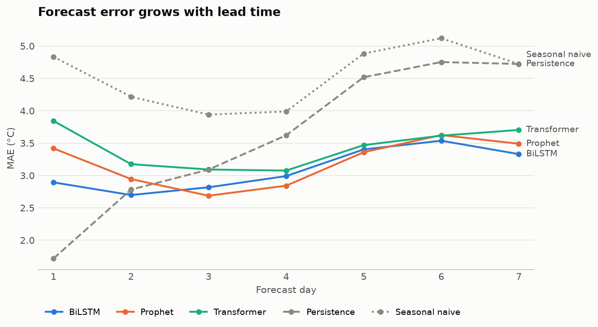
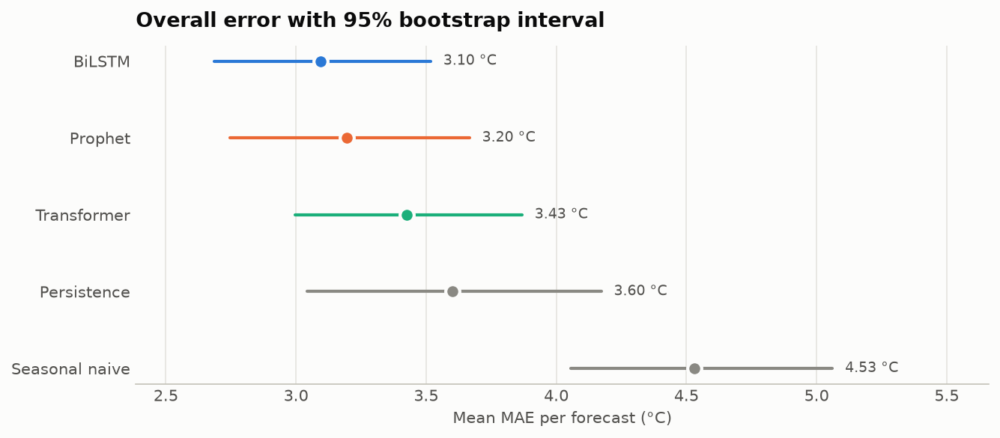
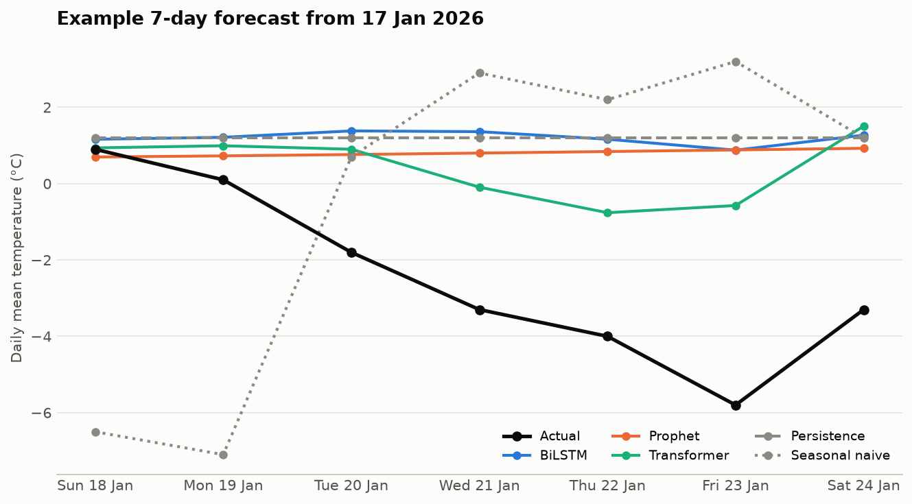

# Berlin Temperature Forecasting

[](https://github.com/dipdhru/berlin-temperature-forecasting/actions/workflows/ci.yml)


**Can deep learning beat simple rules at forecasting next week's temperature?** This project
compares a **Bidirectional LSTM**, a **Transformer** and **Prophet** for 1–7 day forecasts of
Berlin's daily mean temperature, against two naive baselines, under a strict leakage-controlled
rolling-origin evaluation. It is the code behind my MSc Data Science & AI thesis.

📄 [Thesis (PDF)](thesis.pdf) · 🌡️ [Live forecast app](#live-forecast-app) · 🔁 [Reproduce the results](#reproduce-the-results)

## Key results

Evaluated on **44 weekly, non-overlapping forecasts** (25 Oct 2025 – 22 Aug 2026). Every model is
refitted at each forecast date using only data available on that day.



| Model | MAE (°C) | RMSE (°C) | R² | MAE 95% CI |
|---|---:|---:|---:|---|
| **BiLSTM** | **3.10** | **3.83** | **0.81** | 2.68 – 3.52 |
| Prophet | 3.20 | 4.05 | 0.79 | 2.75 – 3.67 |
| Transformer | 3.43 | 4.22 | 0.78 | 3.00 – 3.87 |
| Persistence (repeat last day) | 3.60 | 4.59 | 0.73 | 3.04 – 4.17 |
| Seasonal naive (same day last week) | 4.53 | 5.52 | 0.62 | 4.06 – 5.06 |

**What the results say**

1. **The BiLSTM is best overall, but not decisively.** Its bootstrap interval overlaps Prophet's,
   so on 44 forecasts the two cannot be separated with confidence.

   

2. **For tomorrow, nothing beats "same as today".** Persistence has a day-1 error of 1.72 °C versus
   2.89 °C for the best model. The learned models only pay off from day 2, where persistence
   degrades fast (4.7 °C by day 7).
3. **The Transformer did not earn its complexity.** With about 1,450 training days it trailed the
   simpler BiLSTM at every horizon, and tuning did not improve it
   ([tuning_comparison.csv](results/tuning_comparison.csv)).
4. **Sudden weather changes are out of reach.** In the cold snap below, the three learned
   models stayed between −1 and +1.5 °C while temperatures fell to almost −6 °C. Statistical models that only see
   Berlin's own history cannot anticipate incoming air masses; physics-based weather models can.

   

## Method

| Step | Choice | Why |
|---|---|---|
| Data | Open-Meteo archive (ERA5 reanalysis), 1 Jan 2021 – 31 Aug 2026, 10 daily variables + day-of-year sin/cos | Free, consistent, reproducible |
| Split | Chronological 70 / 15 / 15 | No shuffling in time series |
| Leakage control | Scalers refitted at every forecast origin on past data only; forward-fill only | Test data never influences training |
| Neural models | 30-day input window, **direct** 7-day output (one pass predicts all seven days) | Avoids compounding errors of recursive forecasting |
| Tuning | Keras Tuner random search (8 trials each); Prophet: 12 configs on 3 validation origins | Tuned on validation data, never on test |
| Evaluation | 44 weekly origins, non-overlapping windows; MAE, RMSE, R², sMAPE, MASE; bootstrap CIs over origins | Independent forecasts and honest uncertainty |

sMAPE is reported but not emphasised: temperatures near 0 °C make percentage errors explode.

## Live forecast app

A Streamlit app retrains the BiLSTM and Prophet on the latest five years of data each day and
shows the coming week next to Open-Meteo's professional forecast.

```bash
pip install -e ".[app]"
streamlit run app/streamlit_app.py
```

To host it for free, sign in at [share.streamlit.io](https://share.streamlit.io), choose this
repository, and set the main file to `app/streamlit_app.py`.

## Reproduce the results

```bash
git clone https://github.com/dipdhru/berlin-temperature-forecasting.git
cd berlin-temperature-forecasting
python -m venv .venv && source .venv/bin/activate
pip install -e ".[dev]"

pytest                                          # 19 tests, incl. re-deriving the thesis tables
python scripts/run_pipeline.py --max-origins 3  # quick check, ~3 minutes
python scripts/run_pipeline.py                  # full 44-origin evaluation, ~40 min on a laptop CPU
python scripts/run_pipeline.py --tune           # also re-run hyperparameter search
python scripts/make_figures.py                  # redraw the README figures
```

Pipeline runs write to `runs/<timestamp>/`, so the published results in `results/` are never
overwritten. A rerun gives numbers close to, but not identical with, the thesis, for two reasons:

- **Data revisions.** Open-Meteo replaces its preliminary reanalysis (ERA5T) with final ERA5
  values a few months later. Some late-2025 test days have since moved by up to ±0.2 °C. The
  pipeline caches each download in `data/` so your own reruns stay consistent.
- **Hardware.** Neural network training is not bit-for-bit deterministic across CPUs and GPUs.

The tests check the part that *is* exactly reproducible: recomputing every published metric and
confidence interval from the saved thesis predictions.

## Project structure

```
├── app/streamlit_app.py        live 7-day forecast
├── src/berlin_forecast/
│   ├── config.py               experiment settings (loads tuned values from results/config.json)
│   ├── data.py                 Open-Meteo download and leakage-safe cleaning
│   ├── features.py             splits, scaling, calendar features, sequence windows
│   ├── baselines.py            persistence and seasonal-naive forecasts
│   ├── models.py               BiLSTM, Transformer encoder, Prophet
│   ├── tuning.py               Keras Tuner and Prophet search
│   ├── evaluate.py             rolling-origin evaluation
│   ├── metrics.py              MAE/RMSE/R²/sMAPE/MASE, bootstrap intervals
│   └── plots.py                result figures
├── scripts/                    run_pipeline.py, make_figures.py
├── tests/                      unit tests + thesis reproduction tests
├── results/                    thesis run: predictions, metrics, tuned config
├── notebooks/
│   ├── V2.1_final.ipynb        original thesis notebook
│   └── archive/                earlier iterations (V2, V1)
├── docs/figures/
└── thesis.pdf
```

## Author

**Dipanshu Singh** · MSc Data Science & AI, Berlin ·
[LinkedIn](https://www.linkedin.com/in/dipanshu-s-b94384174/) · [GitHub](https://github.com/dipdhru)

Weather data by [Open-Meteo](https://open-meteo.com/), licensed CC BY 4.0.
